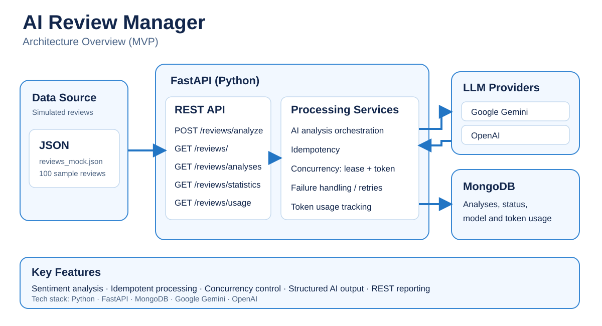
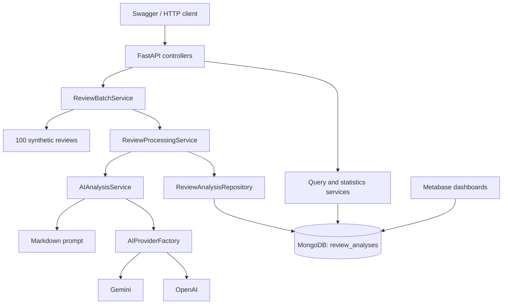

# AI Review Manager

**AI-powered customer review analysis, processing reliability, and business intelligence**

AI Review Manager is a Python/FastAPI learning and portfolio project that turns customer feedback into structured, actionable insights using Google Gemini or OpenAI. It processes a synthetic iFood-style review dataset, stores AI results in MongoDB, exposes reporting APIs, and can be explored with Metabase dashboards.

**Status: MVP implemented and demonstrated locally.** The API, MongoDB persistence, batch processing, reporting endpoints, and local Metabase exploration have been exercised. This is a demonstration project, **not a production-ready iFood integration**.

## Highlights

- **100 synthetic reviews** in `data/reviews_mock.json`, with a review listing endpoint.
- **LLM abstraction:** provider interface, factory, Gemini and OpenAI adapters, external Markdown prompt, and validated analysis schema.
- **Structured insights:** sentiment (`POSITIVE`, `NEGATIVE`, `NEUTRAL`, `MIXED`), satisfaction score, reasons, keywords, praises, criticisms, categories, severity, human-attention flag, and suggested reply.
- **End-to-end batch analysis:** `POST /reviews/analyze` selects uncompleted mock reviews and processes them through the AI service.
- **MongoDB persistence:** original review comment, analysis, processing state, model/provider metadata, token usage, and timestamps.
- **Idempotent coordination:** compound unique identity index, atomic processing leases, token-checked completion, failure recording, and cached completed results.
- **Reporting APIs:** paginated/filterable analyses, individual analysis, aggregate statistics, and token usage with optional cost estimates.
- **Metabase compatibility:** connect directly to MongoDB to build operational and sentiment dashboards.
- **Automated tests:** pytest suite with mocked external dependencies.

## Tech Stack

| Layer | Technology |
|---|---|
| API | Python 3.13, FastAPI, Uvicorn |
| Validation and configuration | Pydantic, Pydantic Settings |
| AI | Google Gen AI SDK (Gemini), OpenAI SDK |
| Persistence | MongoDB, PyMongo |
| Analytics | MongoDB aggregation pipelines, Metabase (optional, separate installation) |
| Tests | pytest |
| Local tooling | Git, PowerShell, optional Docker |

## Architecture





The batch service currently uses a fixed demonstration tenant (`nuvem-roxa-001`) and platform (`IFOOD`). It **does not fetch reviews from iFood**; those identifiers describe the synthetic dataset. Metabase is a separate tool connected to the database, not a frontend embedded in FastAPI.

### Processing and failure behavior

1. The batch service loads mock reviews and excludes already-completed items.
2. `try_acquire()` atomically reserves each review with a UUID token and time-limited lease.
3. The selected AI provider analyzes the comment; the result is validated with `AIAnalysisResult`.
4. `complete()` saves the result only while the processing token still owns a valid lease.
5. Errors are registered through `fail()` when the worker still owns the reservation. Failed reviews can be retried.
6. Previously completed reviews can be returned from persistence instead of calling the model again.

The unique MongoDB index on `(tenant_id, platform, external_review_id)` prevents duplicate review identities. **This is not exactly-once external AI execution:** a crash after the provider call or an expired lease can cause another provider call, although a stale worker cannot overwrite a newer completed result.

## Project Layout

```text
app/
  controllers/     # Health, reviews, analysis, reports
  core/            # Settings, database, dependencies, model rates
  models/          # Review, structured AI output, stored analysis, API schemas
  prompts/         # Brand-specific review analysis instructions
  providers/       # Provider interface, factory, Gemini, OpenAI
  repositories/    # MongoDB persistence and queries
  services/        # AI analysis, processing, batch, query and statistics
  main.py          # FastAPI application
data/
  reviews_mock.json
tests/             # Automated tests
test_ai.py         # Manual AI smoke test
.env.example
requirements.txt
README.md
```

## Run Locally

### Requirements

- Python 3.13 and Git
- A reachable MongoDB server (installed locally or containerized)
- A Gemini API key or an OpenAI API key
- Optional: Docker Desktop and Metabase for dashboards

### 1. Clone and install

```powershell
git clone https://github.com/osnjunior91/ai-review-manager.git
cd ai-review-manager
python -m venv .venv
.\.venv\Scripts\Activate.ps1
python -m pip install -r requirements.txt
```

On macOS/Linux: `source .venv/bin/activate`.

### 2. Configure environment

```powershell
Copy-Item .env.example .env
```

Edit `.env` to match your local database and provider:

```dotenv
APP_NAME="AI Review Manager"
API_VERSION="1.0.0"
APP_DESCRIPTION="AI-powered customer review management API"

MONGODB_URI=mongodb://127.0.0.1:27017
MONGODB_DATABASE=ai_review_manager

AI_PROVIDER=gemini
AI_MODEL=gemini-2.5-flash-lite
AI_PROMPT_PATH=app/prompts/review_analysis_prompt.md
GEMINI_API_KEY=your_key_here
```

Choose an AI model available to your account; names and quotas change. To use OpenAI, set `AI_PROVIDER=openai`, choose an available `AI_MODEL`, and configure `OPENAI_API_KEY`.

**Never commit your `.env` file, API keys, or real customer information.**

### 3. Start MongoDB

If MongoDB is installed on Windows, verify it is running:

```powershell
Get-Service MongoDB
Test-NetConnection 127.0.0.1 -Port 27017
```

Alternatively, for an isolated Docker-based MongoDB:

```powershell
docker run -d --name ai-review-mongodb -p 127.0.0.1:27017:27017 -v ai-review-mongo-data:/data/db mongo:8
```

Use **one** MongoDB instance on port 27017; do not start the Docker container if a Windows service already occupies that port.

### 4. Start the API

```powershell
python -m uvicorn app.main:app --reload
```

- Swagger/OpenAPI: http://127.0.0.1:8000/docs
- API: http://127.0.0.1:8000
- Database health: http://127.0.0.1:8000/health/database

### 5. Analyze sample reviews

```powershell
Invoke-RestMethod -Uri "http://127.0.0.1:8000/reviews/analyze" -Method Post -ContentType "application/json" -Body '{"quantity":3}'
```

The `quantity` field accepts 1–100. The response reports requested/available/selected counts, completed/processing/failed counts, and per-review outcomes. Provider calls can consume billable tokens.

A separate manual provider smoke test is available:

```powershell
python test_ai.py
```

## API Reference

| Method | Path | Description |
|---|---|---|
| GET | `/health` | API health |
| GET | `/health/database` | MongoDB connectivity |
| GET | `/version` | Version |
| GET | `/reviews/` | Synthetic review dataset |
| POST | `/reviews/analyze` | Batch AI analysis of random eligible reviews |
| GET | `/reviews/analyses` | Paginated stored analyses with filters |
| GET | `/reviews/analyses/{analysis_id}` | One stored analysis by MongoDB ObjectId |
| GET | `/reviews/statistics` | Sentiment, satisfaction, categories, severity and attention statistics |
| GET | `/reviews/usage` | Token usage and optional estimated model cost |

### Reporting examples

```text
GET /reviews/analyses?page=1&page_size=20&status=COMPLETED&sentiment=NEGATIVE
GET /reviews/analyses?tenant_id=nuvem-roxa-001&platform=IFOOD&requires_attention=true
GET /reviews/statistics?tenant_id=nuvem-roxa-001
GET /reviews/usage?group_by=model
GET /reviews/usage?group_by=day&ai_provider=gemini
```

`/reviews/analyses` supports `page`, `page_size` (maximum 100), `tenant_id`, `platform`, `status`, `sentiment`, `severity`, `requires_attention`, `start_date`, and `end_date`. The detail endpoint accepts an optional `tenant_id`.

`/reviews/statistics` supports tenant, platform and date filters. `/reviews/usage` supports tenant, provider, model and date filters plus `group_by=day|month|model|provider`. Date intervals use UTC, inclusive start and exclusive end; consult Swagger for schemas and validation.

### AI analysis schema

```json
{
  "sentiment": "MIXED",
  "satisfaction_score": 6,
  "score_reason": "The customer liked the product but reported slow delivery.",
  "keywords": ["product", "delivery"],
  "praises": ["product quality"],
  "criticisms": ["delivery delay"],
  "categories": ["PRODUCT", "DELIVERY"],
  "severity": "MEDIUM",
  "requires_attention": false,
  "suggested_reply": "Thank you for your feedback. We're glad you enjoyed the product and sorry about the delay."
}
```

This is an illustrative example, not a live response. The project prompt targets **Nuvem Roxa**, a fictional Brazilian açaí/ice cream business. Generated replies should be reviewed by a human before publishing.

## Analytics with Metabase

Metabase can read the `review_analyses` MongoDB collection and visualize:

- Total analyses and processing status (`COMPLETED`, `FAILED`, `PROCESSING`)
- Sentiment distribution and satisfaction
- Negative reviews, severity, and items requiring attention
- Frequent categories, criticisms, and keywords
- Provider/model usage and token consumption

**Local setup:** Run Metabase separately (for example, in Docker), add a MongoDB data source, and select the actual database containing `review_analyses`. If Metabase is in Docker and MongoDB runs on the Windows host, a typical connection URI is:

```text
mongodb://host.docker.internal:27017/ai_review_manager?directConnection=true
```

Replace `ai_review_manager` with the real database name. The host must be reachable from the container; firewall, MongoDB bind addresses, and authentication can affect connectivity. Do not expose MongoDB publicly just to connect a local dashboard.

To create a chart in Metabase, select `Review Analyses`, filter `Status = COMPLETED`, summarize `Count`, group by `Analysis: Sentiment`, and choose a pie/donut visualization. Save the question and add it to a dashboard. For a total-reviews KPI, summarize `Count` without a status filter and use the Number visualization.

**Dashboard configuration is stored in the separate Metabase instance**, not automatically included in this repository.

## Usage and Cost Notes

The provider response tracks input, output, and total tokens when available; MongoDB reporting aggregates persisted usage. Estimated USD cost requires verified provider rates in `app/core/model_rates.py`, which is intentionally empty by default. Missing rates or usage values produce incomplete or unavailable cost estimates rather than fabricated amounts. Failed external calls may consume tokens without a persisted usage record.

A one-review prompt optimization experiment reduced observed total tokens from 1,625 to 594 (63.4%). This is a single local comparison, **not a statistically validated average**.

## Tests

```powershell
python -m pytest -q tests
```

Tests use mocks for key service/repository and endpoint behavior. Run the manual `test_ai.py` separately when you explicitly want to exercise a live provider.

## Scope and Future Improvements

**Completed MVP:** REST API, synthetic review processing, structured AI insights, MongoDB storage, reservation/idempotency safeguards, retryable failures, statistics and usage endpoints, and local Metabase visualization.

**Not included / future work:** real iFood API integration and credentials, authentication and authorization for a multi-tenant production deployment, a complete approval/publishing workflow for suggested replies, production observability, lease heartbeat for long-running jobs, and production deployment hardening. OpenAI and Gemini may differ in their schema-enforcement details; verify provider behavior independently.

## Security

Use synthetic data for development. Keep provider keys out of Git, restrict MongoDB network access, and review privacy/provider policies before processing real customer feedback. Treat AI-generated sentiment and replies as suggestions, not guaranteed facts.

## License

MIT License; see `LICENSE`.

---

**AI Review Manager** — *Turning customer feedback into actionable insights.*
